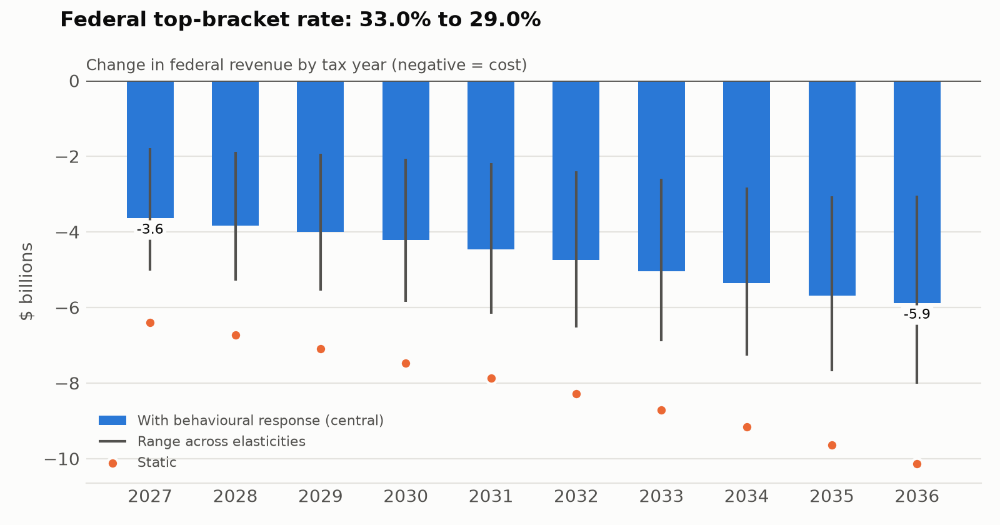

# Federal top-bracket rate: 33.0% to 29.0%

*Score memo · Fiscal Workbench (static and behavioural estimates) · October 20, 2026*

## Bottom line

- **Change in federal revenue, 2027–2036: -$46.9B** in the central case, with a range of -$64.3B to -$23.8B across plausible behavioural responses. Negative numbers are a cost.
- Static estimate (no behavioural change): -$81.5B. First full year (2027): -$3.6B central, -$6.4B static.
- Including extra interest on the debt (at the current 10-year bond yield of 3.93%): -$55.3B.
- Knock-on change in provincial revenue (central case): $24.5B over the same period. This is not a federal cost, but provinces would feel it.

## Annual estimates ($ billions)

| Year | Static | Low elasticity | Central | High elasticity | Provincial |
|---|---:|---:|---:|---:|---:|
| 2027 | -6.4 | -5.0 | -3.6 | -1.8 | 2.0 |
| 2028 | -6.7 | -5.3 | -3.8 | -1.9 | 2.1 |
| 2029 | -7.1 | -5.6 | -4.0 | -1.9 | 2.2 |
| 2030 | -7.5 | -5.9 | -4.2 | -2.1 | 2.3 |
| 2031 | -7.9 | -6.2 | -4.5 | -2.2 | 2.4 |
| 2032 | -8.3 | -6.5 | -4.7 | -2.4 | 2.5 |
| 2033 | -8.7 | -6.9 | -5.0 | -2.6 | 2.6 |
| 2034 | -9.2 | -7.3 | -5.4 | -2.8 | 2.7 |
| 2035 | -9.6 | -7.7 | -5.7 | -3.1 | 2.8 |
| 2036 | -10.1 | -8.0 | -5.9 | -3.0 | 3.0 |
| **Total** | **-81.5** | **-64.3** | **-46.9** | **-23.8** | **24.5** |

## How this was estimated

The rate change is applied to the slice of taxable income inside the bracket, using CRA's income distribution grown with nominal GDP, with bracket thresholds indexed to CPI. Quebec residents' share is reduced by the 16.5% abatement. For the lowest bracket, the change in the value of non-refundable credits (which are valued at the lowest rate) is netted off. Behaviour: filers whose top dollar falls in the bracket change their taxable income by the elasticity of taxable income times the percentage change in their combined federal-provincial net-of-tax rate.

There is no macroeconomic feedback: changes to growth, investment or wages are not included.

## Assumptions

| Assumption | Value | Source |
|---|---|---|
| Filers and income | CRA Table 2, 2024 tax year, as about 500 representative filer groups | Grown with nominal GDP; brackets and credits indexed to CPI; calibrated to CRA net federal tax by income range |
| Brackets and rates | 2026 federal schedule | CRA, 2026 federal rates and indexed thresholds (indexation factor 2.0%). |
| Elasticity of taxable income (lower brackets) | 0.05 / 0.14 / 0.25 | Sillamaa & Veall (2001, J. Public Econ.), about 0.14 for Canada's 1988 reform; Saez, Slemrod & Giertz (2012, JEL) survey range. |
| Elasticity of taxable income (top bracket) | 0.2 / 0.4 / 0.66 | Central 0.4: Laurin (C.D. Howe, 2015) for a federal change. High 0.66: Milligan & Smart (2015, CJE) for the top 1%, estimated from provincial variation, so it includes interprovincial shifting and overstates a federal response. |
| Provincial marginal rates by bracket | [0.07, 0.1, 0.12, 0.15, 0.2] | Rough population-weighted provincial marginal rates for each federal bracket. Used only for the behavioural response and the provincial spillover, not the static cost. Low-confidence; refine by province in Phase 2. |
| Quebec abatement | 0.165 | Income Tax Act s.120(2); federal basic tax of Quebec residents is reduced 16.5%. |
| Nominal GDP growth | 0.0375 | Assumption, roughly in line with medium-term nominal GDP growth in recent PBO and Finance Canada outlooks (about 3.5-4%). Check against the latest PBO Economic and Fiscal Outlook before publishing. |

## How this compares

2016 top bracket (29% to 33% above $200,000): more than $3B a year static, about $1.2B after behavioural response (Alexandre Laurin, C.D. Howe Institute).

## Red team: reasons this estimate could be wrong

- CRA groups filers by total income, not taxable income; the spread of taxable income within each range is interpolated.
- Above $250,000 the estimate rests on a Pareto shape fitted to one group average. The top bracket's base is sensitive to that shape.
- Credits other than the basic personal amount are set at each income range's average, so the split between filers who owe tax and those who don't is approximate.
- Below $40,000 of total income the model leaves out about $2.5B of the tax CRA reports (of $223B), which it can't attribute.
- The response is applied to the whole taxable income of affected filers, as in the elasticity-of-taxable-income literature. Some of it is timing (shifting income between years), which flatters the first years.
- Filer counts are held at 2024 levels; incomes per filer grow with nominal GDP. Top incomes are more volatile than GDP.
- Nominal GDP growth after the last published year is an assumption. A recession would shrink every base here.
- The behavioural range reflects the literature, not this proposal. Design details (anti-avoidance rules, transition, announcement timing) can move the real response outside it.
- Tax years are reported, not fiscal years; government budget tables use fiscal years and include timing lags.
- This is a back-of-the-envelope estimate built from published aggregates, not a microsimulation. Treat it as a check on official estimates, not a replacement for them.

## Sources

- Statistics Canada, vector v62305783. <https://www150.statcan.gc.ca/t1/wds/rest/getDataFromVectorsAndLatestNPeriods> (retrieved 2026-10-20). Table 36-10-0104, current prices, SAAR; annual = mean of four quarters.
- Canada Revenue Agency, Individual Income Tax Return Statistics, 2024 tax year, Table 2 (all of Canada). <https://www.canada.ca/content/dam/cra-arc/prog-policy/stats/t1-final-stats/2024-tax-year/tbl2_ac_en.csv> (retrieved 2026-10-20). Amounts in thousands of dollars in the source; converted to dollars on load.
- Canada Revenue Agency, Individual Income Tax Return Statistics, 2024 tax year, Table 2 (QC). <https://www.canada.ca/content/dam/cra-arc/prog-policy/stats/t1-final-stats/2024-tax-year/tbl2_qc_en.csv> (retrieved 2026-10-20). Amounts in thousands of dollars in the source; converted to dollars on load.
- Bank of Canada Valet API, BD.CDN.10YR.DQ.YLD. <https://www.bankofcanada.ca/valet/observations/BD.CDN.10YR.DQ.YLD/json?recent=30> (retrieved 2026-10-20).
- Parameters and literature sources: `assumptions.yaml` in this workbench.
